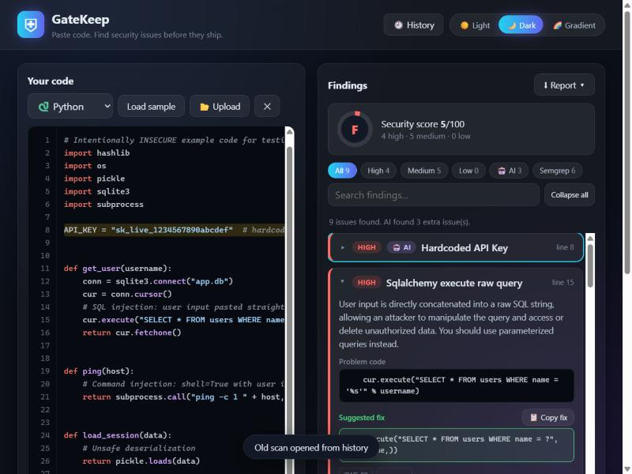
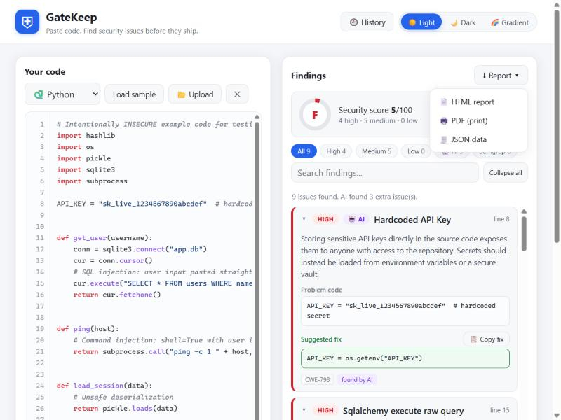
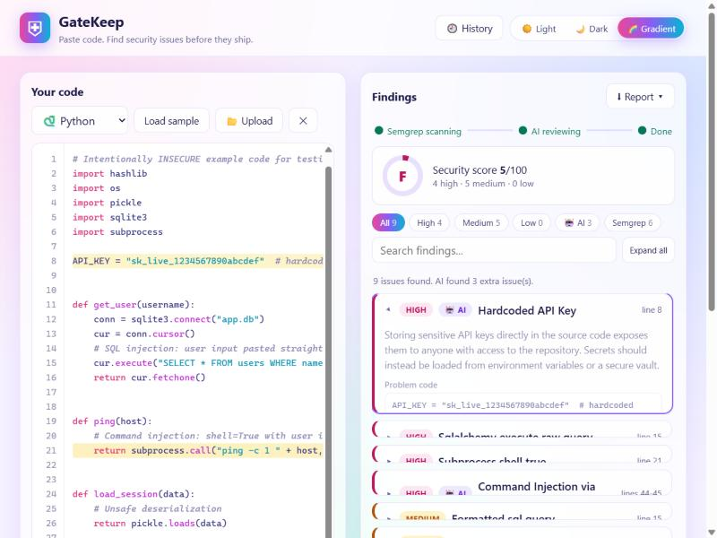
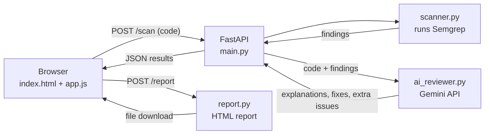

# GateKeep: AI Code Security Gate

**Paste Python or JavaScript code. GateKeep finds the security bugs, explains them in plain language, and suggests a fix.**

GateKeep checks code in two layers:

1. **Semgrep** (static analysis) catches *known* vulnerable patterns fast: SQL injection, command injection, unsafe `eval`, weak hashing.
2. **An AI reviewer** (Google Gemini by default) reads the code like a senior engineer. It explains every Semgrep finding in simple words, and catches what pattern rules miss: hardcoded secrets, broken access control, business-logic bugs.



<p>
  
  
</p>

## Why two layers?

On the included Python sample, Semgrep found 6 issues. The AI layer found **3 more that Semgrep missed**:

| Line | Issue | Found by |
|------|-------|----------|
| 8 | Hardcoded API key | AI |
| 15 | SQL injection | Semgrep |
| 21 | Command injection (`shell=True`) | Semgrep |
| 26 | Unsafe `pickle` deserialization | Semgrep |
| 31 | MD5 used for passwords | Semgrep |
| 36 | `eval()` on user input | Semgrep |
| 39 | `withdraw()` accepts negative amounts (logic bug) | AI |
| 44 | Command injection via `os.system` | AI |

Rules are fast and predictable; AI understands context. Together they cover more than either alone.

## Features

- Python and JavaScript support
- **3 themes**: Light, Dark and Gradient (remembered between visits)
- **Code editor** with line numbers and syntax colours; click a finding to jump to and highlight its line
- **Upload or drag & drop** a `.py` / `.js` file (language detected from the file name)
- **Security score** (0-100, grade A-F) for a quick verdict
- **Filters and search**: by severity, by source (AI / Semgrep), or by text
- **Copy fix** button, collapsible finding cards, step-by-step scan progress
- **Scan history**: the last 10 scans, saved only in your browser
- **Reports**: HTML, PDF (via print) or raw JSON
- Severity (high / medium / low), CWE ID, problem code and a suggested fix for every finding
- Plain-language explanations written for beginners
- Example HTML report: [docs/sample-report.html](docs/sample-report.html)
- Works without AI too: if the AI is off, rate-limited or down, you still get the Semgrep results (graceful degradation)
- Provider-agnostic AI layer: Gemini, Xiaomi MiMo or a local Ollama model, switched with one line in `.env`

## How it works



| File | Job |
|------|-----|
| `frontend/index.html`, `style.css`, `app.js` | The web page: paste code, show finding cards, download the report |
| `backend/main.py` | FastAPI server: `/scan`, `/report`, serves the page |
| `backend/scanner.py` | Runs Semgrep on the code and cleans up its output |
| `backend/ai_reviewer.py` | Sends code + Semgrep findings to the AI, validates its JSON answer |
| `backend/report.py` | Builds the downloadable HTML report |
| `samples/` | Intentionally insecure demo code |
| `tests/` | Automated tests (`pytest`) |

## Security of GateKeep itself

A security tool should not be insecure:

- **No XSS:** user code is shown with `textContent` in the page and `html.escape()` in the report, never as raw HTML.
- **Prompt-injection aware:** the AI is told the code is untrusted data, and its answer is validated (types, severities, line numbers) before use.
- **Secrets stay local:** the API key lives in `.env`, which is gitignored.
- **Input limits:** code is capped at 50,000 characters; only Python/JavaScript are accepted.

## Run it locally (Windows)

```powershell
git clone https://github.com/evaabuilds/gatekeep.git
cd gatekeep

# 1. App environment
python -m venv .venv
.\.venv\Scripts\pip install -r requirements.txt

# 2. Semgrep in its own environment (avoids dependency clashes).
#    --only-binary makes pip use Semgrep's ready-made Windows build.
python -m venv tools\semgrep-env
.\tools\semgrep-env\Scripts\pip install --only-binary=semgrep semgrep

# 3. AI key (optional): free key from https://aistudio.google.com/apikey
copy .env.example .env
notepad .env      # paste your key after AI_API_KEY=

# 4. Start
.\.venv\Scripts\uvicorn backend.main:app --reload
```

Open http://127.0.0.1:8000, click **Load sample**, then **Scan code**.

After the first setup, one command does it all (checks setup, starts the server, opens the browser):

```powershell
.\start.ps1
```
API docs are at http://127.0.0.1:8000/docs.

Run the tests:

```powershell
.\.venv\Scripts\python -m pytest
```

## Tech stack

Python 3 · FastAPI · Semgrep Community Edition · Google Gemini API (OpenAI-compatible endpoint) · httpx · plain HTML/CSS/JavaScript · pytest

## Limitations

- AI suggestions can be wrong. Always review a fix before using it.
- Semgrep rule packs are downloaded from the Semgrep Registry, so scanning needs internet.
- The free Gemini tier has rate limits and is sometimes busy; GateKeep then shows Semgrep results only.
- Don't paste confidential company code: free-tier AI providers may use inputs to improve their products.

## Roadmap

- [x] Project setup + health endpoint
- [x] Semgrep scan endpoint (`POST /scan`)
- [x] Web page to paste code and see findings
- [x] AI layer for logic issues, explanations and fixes
- [x] Downloadable HTML report
- [x] Polish: README, tests, one-click start
- [ ] Ideas: more languages, scan a whole GitHub repo, cache Semgrep rules for offline use

Built by [Eva](https://github.com/evaabuilds) as a learning project.
