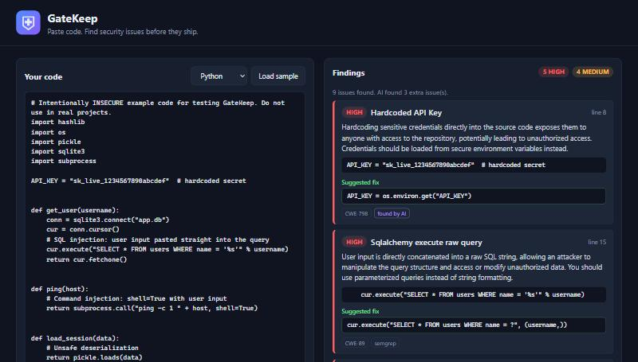

# GateKeep: AI Code Security Gate

Paste Python or JavaScript code and GateKeep checks it for security problems in two layers:

1. **Semgrep** finds known vulnerable patterns (SQL injection, hardcoded secrets, unsafe eval, ...).
2. **AI review** (Gemini) finds logic and context issues a pattern scanner misses.

Each finding comes with a severity, a plain-language explanation, and a suggested fix. Results can be downloaded as a report.

> Status: work in progress (Milestone 5 of 6: Semgrep + AI review + downloadable report).



## Tech stack

- Python + FastAPI backend
- Semgrep Community Edition (free)
- AI reviewer: any OpenAI-compatible API. Google Gemini (free tier) by default; Xiaomi MiMo and local Ollama also supported. Set it up by copying `.env.example` to `.env` and adding your key.
- Plain HTML/CSS/JavaScript frontend

## Run locally (Windows)

```powershell
python -m venv .venv
.\.venv\Scripts\pip install -r requirements.txt

# Semgrep lives in its own environment to avoid dependency clashes
python -m venv tools\semgrep-env
.\tools\semgrep-env\Scripts\pip install semgrep

.\.venv\Scripts\uvicorn backend.main:app --reload
```

Open http://127.0.0.1:8000 for the web page (or /docs for the API), or scan a sample file from a second terminal:

```powershell
.\.venv\Scripts\python scripts\try_scan.py samples\vulnerable.py python
```

`samples/` holds intentionally insecure Python and JavaScript code for testing.

## Roadmap

- [x] 1. Project setup + health endpoint
- [x] 2. Semgrep scan endpoint (`POST /scan`)
- [x] 3. Web page to paste code and see findings
- [x] 4. AI layer for logic issues, explanations and fixes
- [x] 5. Downloadable HTML report (`POST /report`, "Download report" button). Example: [docs/sample-report.html](docs/sample-report.html)
- [ ] 6. Polish: tests, screenshots, sample vulnerable code

